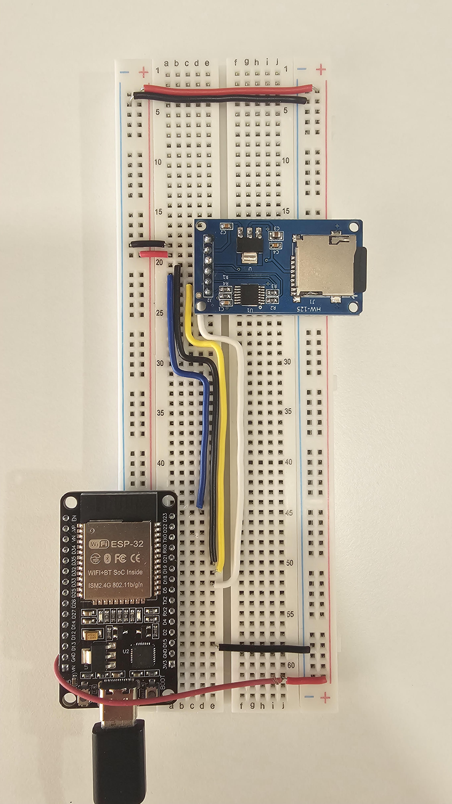

# ESP32 + HW-125 MicroSD Card Adapter

A simple ESP32 project that initializes an HW-125 SPI microSD adapter, reports the card capacity, and writes a text message to `hello.txt`.




## Project overview

The ESP32 communicates with the HW-125 microSD adapter over SPI. When the board starts, the sketch:

1. Starts the serial monitor at **115200 baud**.
2. Initializes the SPI bus using the configured ESP32 pins.
3. Initializes the SD card at a **1 MHz SPI clock**.
4. Prints the detected card capacity.
5. Opens `/hello.txt` and writes `Hi from ESP32!`.

## Hardware

- ESP32 development board (ESP32-WROOM-32 / DevKit-style)
- HW-125 MicroSD Card Adapter (SPI)
- microSD card (tested with a 2 GB card formatted as FAT32)
- Breadboard and jumper wires
- USB cable for programming and power

## Wiring

The pin assignments below are taken directly from the sketch.

| HW-125 pin | ESP32 pin | GPIO / signal |
|---|---|---|
| CS | D5 | GPIO 5 |
| SCK | D18 | GPIO 18 / SPI clock |
| MOSI | D23 | GPIO 23 / SPI controller output |
| MISO | D19 | GPIO 19 / SPI controller input |
| VCC | Appropriate module supply | See power note below |
| GND | GND | Common ground |


### Power and logic-level note

The pictured HW-125 board includes an AMS1117-3.3 regulator and a 74LVC125 logic buffer. Check the specifications of your exact adapter before choosing its VCC input. Do not assume that the regulator makes every signal or every board revision safe at any voltage. The ESP32 GPIO pins are **3.3 V logic**; do not apply 5 V to ESP32 GPIO pins. Connect the ESP32 and adapter grounds together.

## Software

- Arduino IDE
- ESP32 board support package installed in Arduino IDE
- The `SPI.h` and `SD.h` libraries supplied with the Arduino-ESP32 core

No separate SD library installation is normally required when using the standard Arduino-ESP32 package.

## Installation and upload

1. Connect the HW-125 adapter to the ESP32 using the wiring table.
2. Insert a supported microSD card. This project was tested with a 2 GB FAT32 card.
3. Open `ESP32_HW125_SDCard.ino` in Arduino IDE.
4. Select the correct ESP32 board and COM port.
5. Upload the sketch.
6. Open Serial Monitor and set the baud rate to **115200**.

## Expected serial output

A successful run should look similar to:

```text
HW-125 SD Card Test
SD initialization SUCCESS!
Card size: 1903 MB
File written successfully!
```

The reported capacity can vary slightly depending on the card. A 2 GB card may be reported as approximately 1900 MB.

## File created on the SD card

The sketch creates or opens:

```text
/hello.txt
```

It writes this line:

```text
Hi from ESP32!
```

Remove the card and open `hello.txt` on a computer to inspect the contents.

## Important behavior: appending data

The sketch uses:

```cpp
SD.open("/hello.txt", FILE_WRITE);
```

With the Arduino SD library, `FILE_WRITE` opens the file for writing and appends to an existing file. Therefore, each ESP32 restart can add another `Hi from ESP32!` line.

To start with a clean file each time, remove the existing file before opening it:

```cpp
if (SD.exists("/hello.txt")) {
  SD.remove("/hello.txt");
}

File file = SD.open("/hello.txt", FILE_WRITE);
```

Only use this if you intentionally want to erase the previous contents of `hello.txt` on every startup.

## Troubleshooting

If `SD initialization FAILED!` appears:

1. Recheck the six connections, especially CS, SCK, MOSI, and MISO.
2. Confirm that the CS wire is connected to **GPIO 5**, matching `#define SD_CS 5`.
3. Confirm that the SPI pins in the wiring match the `sdSPI.begin()` call.
4. Confirm that the adapter and ESP32 share a common GND.
5. Check the adapter's required VCC voltage and logic compatibility.
6. Try a known-good microSD card and a supported FAT-formatted filesystem.
7. Keep SPI wires short and make sure the card is fully inserted.

If you change the CS wire to another GPIO, update `SD_CS` in the sketch to match.

## Source code

See [`ESP32_HW125_SDCard.ino`](ESP32_HW125_SDCard.ino).

## License

Add a license file if you want to specify how others may use, modify, and distribute this project. For a simple public GitHub project, the MIT License is a common option.
